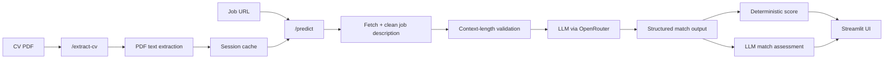

# Job Match Hunter

> An end-to-end LLM application that compares a candidate's CV with a job posting and returns a structured assessment of how well the two match.

**Status:** first deployment in progress.

Job Match Hunter is a portfolio project built to explore how to design, evaluate, and ship a production-oriented AI system rather than only prototype an LLM prompt. A user uploads a CV as a PDF, provides a job-posting URL, and receives:

- a deterministic match score based on the job requirements identified by the model;
- a short LLM-generated match assessment;
- the requirements the CV appears to meet and not meet;
- the job requirements categorized as mandatory, optional, or uncategorized.

The score is intended as a **screening aid**, not as an estimate of the candidate's probability of being hired.

## Why I built it

Reading job descriptions and deciding whether a position is worth pursuing is repetitive and time-consuming. The goal of this project is to reduce that first-pass screening effort while also serving as a case study in end-to-end AI engineering: problem scoping, model and prompt evaluation, structured outputs, API design, error handling, privacy constraints, frontend integration, CI, and deployment.

## System overview



A key design decision was to **avoid a multi-stage CV-parser → JD-parser → matcher pipeline in the deployed matching path**. Early experiments showed that errors in separately extracted representations could propagate downstream. The current approach gives the matching model the raw CV and job-description text together and asks it to return a constrained structured comparison. This reduced the number of inference calls and made the final score easier to compute deterministically.

More detail: [System architecture](docs/architecture.md)

## AI engineering approach

The project was developed experimentally rather than by selecting a model and prompt upfront.

### 1. MVP and feasibility

The first MVP answered one question:

> Can an affordable, off-the-shelf language model extract useful structured information from CVs and job descriptions?

The answer was yes, but the experiments also exposed recurring failure modes such as unsupported information, missed requirements, and incorrect duration estimates.

### 2. Model and prompt benchmarking

I benchmarked candidate models using three main criteria:

- **output quality**
- **latency**
- **cost**

The initial model pool was filtered by application constraints including text input, structured-output support, required request parameters, pricing, and zero-data-retention support. Prompt variants were evaluated systematically rather than selected by intuition.

One useful result was that **model and prompt quality were task-dependent**: the best configuration for CV extraction was not the best configuration for job-description extraction. This was one of the reasons not to assume that one model/prompt strategy should be reused across every LLM task.

### 3. Architecture re-evaluation

The original architecture parsed the CV and JD independently before matching them. Benchmarking showed that this introduced avoidable error propagation and did not provide enough reliability for deterministic downstream semantic comparison.

I therefore tested a simpler alternative: provide the raw CV and JD text directly to the match model, constrain its response with a JSON Schema, and compute the numerical score from the returned requirement sets.

That became the current design.

Full methodology and results: [Model, prompt, and match evaluation](docs/evaluation.md)

## Match calculation

The LLM returns structured fields including:

- `jd_requirements`
- `mandatory`
- `optional`
- `met`
- `unmet`
- `match_evaluation`

The numerical score is computed in application code rather than generated by the model:

```text
match_score = len(met) / len(jd_requirements)
```

The LLM therefore performs the semantic comparison, while the percentage calculation remains deterministic.

See [Backend and API design](docs/backend.md).

## Backend

The backend is implemented with **FastAPI**. Its two core application endpoints are:

- `POST /extract-cv`: extracts text from an uploaded PDF.
- `POST /predict`: receives the extracted CV text and a job-posting URL, retrieves the job description, requests the structured LLM comparison, computes the match score, and returns the result.

LLM calls use the **OpenAI Python client** together with **OpenRouter's OpenAI-compatible API**. OpenRouter is used as the model gateway so model providers can be changed with minimal application-level coupling.

Requests are restricted to provider routes that support the parameters required by the application and **zero data retention (ZDR)**.

Unexpected backend failures are handled centrally and can be logged for debugging. Expected external retrieval failures, such as an inaccessible job-posting URL, are surfaced to the frontend with a specific user-facing error instead of a generic 500 response.

More detail: [Backend and API design](docs/backend.md)

## Frontend

The frontend is built with **Streamlit**.

The user flow is intentionally small:

1. Upload a CV as PDF.
2. Paste a job-posting URL.
3. Click **Estimate match**.
4. Review the score, explanation, met/unmet requirements, and requirement categories.

To avoid repeatedly extracting the same CV, the frontend hashes the PDF bytes with SHA-256 and caches the extracted text in the current Streamlit session. The candidate's CV text is not persisted as application data.

More detail: [Frontend and data handling](docs/frontend.md)

## Technology stack

| Area | Technology |
|---|---|
| Programming Language | Python |
| API | FastAPI |
| Frontend | Streamlit |
| LLM access | OpenAI Python client + OpenRouter |
| Structured generation | JSON Schema / structured outputs |
| PDF ingestion | PyMuPDF |
| Job-page ingestion | HTTP + HTML parsing |
| Validation / models | Pydantic |
| Token validation | tiktoken |
| Experiment / error data | Supabase |
| Testing | pytest |
| CI | GitHub Actions |
| Environment / dependency management | uv |

## Repository structure

```text
job-match-hunter/
├── app/                       # FastAPI endpoints
├── data/                      # CV and JD examples used for model benchmarking
├── docs/                      # Detailed project documentation
│   ├── architecture.md
│   ├── evaluation.md
│   ├── backend.md
│   ├── frontend.md
│   └── decisions.md
├── evaluation/                # Benchmarking and evaluation scripts
├── frontend/                  # Streamlit frontend
├── src/
│   └── job_match_hunter/      # Core application and backend logic
│       ├── clients/           # LLM-related code
│       ├── data_layer/        # Supabase client instantiation
│       ├── ingestion/         # CV and JD parsing, and file loading functionality
│       ├── output_processing/ # LLM's output formatting and match calculation
│       ├── prompts/           # Versioned LLM prompts
│       └── schemas/           # JSON schemas for structured outputs
├── tests/                     # Unit and integration tests
├── .github/
│   └── workflows/             # CI workflows
├── .env.example               # Example environment configuration
├── pyproject.toml             # Project metadata and dependencies
├── uv.lock                    # Locked dependency versions
└── README.md                  # Project overview
```

The repository separates application code, AI artifacts, evaluation, tests, and documentation so that each part of the system can evolve independently.

## Engineering decisions worth highlighting

Some of the most important decisions:

- benchmark prompts and models at all levels of processing involving LLMs;
- version prompts and JSON Schemas because both affect model behavior;
- pair human-reviewed evaluation with automated judge (rather than trusting an automated judge alone);
- prefer different model/prompt configurations when the benchmark supports it;
- abandon the initial multi-stage matching architecture when experiments exposed error propagation;
- separate probabilistic semantic reasoning from deterministic score calculation;
- cache CV extraction per frontend session;
- restrict LLM routing to zero-data-retention providers;
- centralize unexpected API error handling while giving known external failures specific responses.

The reasoning behind these choices is documented in [Engineering decisions](docs/decisions.md).

## Current limitations

- LLM outputs can still contain extraction or reasoning errors.
- Job pages with unusual rendering, authentication, bot protection, or inaccessible content may not be retrievable.
- The current benchmark is intentionally small and should be expanded before treating model rankings as broadly generalizable.
- Inputs that exceed the model's context window raise an exception instead of being processed in chunks.

## Next steps

- deploy the first public version;
- expand the end-to-end CV/JD match benchmark;
- compare additional candidate models against the current matching configuration;
- strengthen monitoring and error analysis using real application failures;
- add user feedback signals for match quality;
- continue improving CI/CD and deployment automation.

## Documentation

For readers who want the implementation and experimental detail behind the project:

- [System architecture](docs/architecture.md)
- [Model, prompt, and match evaluation](docs/evaluation.md)
- [Backend and API design](docs/backend.md)
- [Frontend and data handling](docs/frontend.md)
- [Engineering decisions](docs/decisions.md)

## Disclaimer

Job Match Hunter uses generative AI and can make mistakes. Its output should be treated as decision support and verified by the user before making application decisions.
