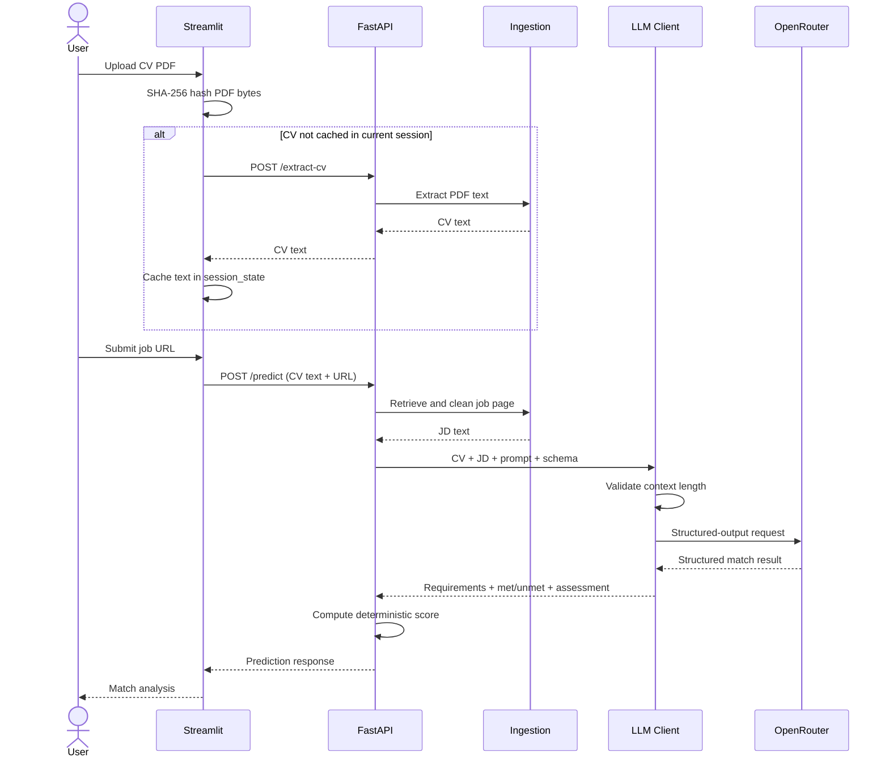

# System Architecture

[← Back to README](../README.md)

## Purpose

Job Match Hunter compares a candidate CV against a job posting and returns both a structured requirement-level comparison and a numerical match score.

The current architecture is the result of an experimental change from the project's original design.

## Current request flow

## Input layer

### CV

The user uploads a PDF. The PDF is converted to text before it is given to the LLM.

This separation has two advantages:

1. PDF extraction is deterministic and independent of the model provider.
2. During model benchmarking, every model receives the same textual input instead of relying on provider-specific PDF handling.

### Job description

The user provides a job-posting URL. The backend retrieves the page and extracts useful text while removing obvious non-content elements such as scripts, styles, navigation, and footer content. Structured `JobPosting` JSON-LD can be used when it is available.

External page retrieval is a failure boundary of the system: some job sites may be unavailable, protected, or rendered in ways that prevent reliable extraction.

## Why the architecture changed

### Original design

The first architecture used three LLM stages:

1. parse the JD into structured information;
2. parse the CV into structured information;
3. compare the two structured representations.

The motivation was reasonable: remove noise before matching and make the data easier to compare.

### What benchmarking exposed

Separate parsing introduced a new problem: **information loss and extraction errors propagate downstream**.

The benchmark showed recurring failure modes such as:

- unsupported information being generated;
- explicitly stated information being missed;
- duplicated extracted entries;
- incorrect date/duration calculations;
- useful context disappearing when content was over-structured.

Even with structured output, many values remained natural language. A deterministic program would still need to decide whether differently worded CV and JD entries were semantically equivalent.

### Current design

The current matching path sends the raw extracted CV text and raw extracted JD text to the same match request.

The model's task is to return a constrained structured comparison containing:

- all requirements used for scoring;
- mandatory requirements;
- optional requirements;
- requirements supported by the CV;
- requirements not supported by the CV;
- a short natural-language assessment.

This preserves the original context for the semantic comparison and removes the need to reconcile independently generated representations.

It also reduces the deployed match operation from multiple LLM calls to a single LLM call.

## Probabilistic vs deterministic responsibilities

A deliberate boundary exists between what the LLM decides and what application code decides.

### LLM responsibilities

The model performs tasks that require semantic interpretation:

- identifying job requirements;
- deciding whether requirements are mandatory or optional;
- deciding whether CV evidence supports a requirement;
- generating the short match explanation.

### Application responsibilities

Application code handles operations that should be deterministic:

- input validation;
- PDF extraction;
- URL retrieval and parsing;
- context-length validation;
- score calculation;
- API response formatting;
- caching;
- known error mapping.

The match percentage is computed from the model's structured result rather than generated by the model.

## Context-window validation

Before an inference request is sent, the application counts the tokens required by the messages and structured-output schema. The request should be rejected or handled explicitly if it exceeds the selected model's context length.

This keeps a model limit from becoming an opaque provider-side failure.

## Component boundaries

The system is intentionally modular:

- **ingestion** converts PDFs and webpages into text;
- **LLM client** owns model requests and structured generation;
- **API layer** owns HTTP contracts and error mapping;
- **frontend** owns user interaction and session caching;
- **Supabase** supports experiment tracking and operational error analysis rather than persistent candidate profiles.

This keeps model-provider details out of most of the application and makes individual components easier to test.
